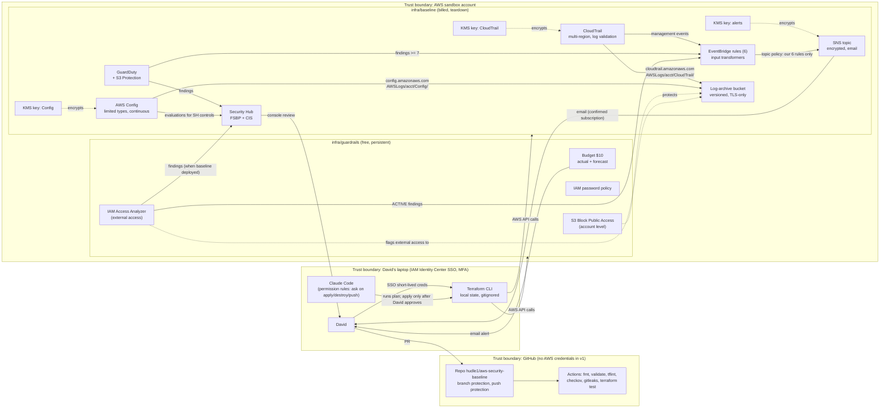

# aws-security-baseline

[](https://github.com/hudle1/aws-security-baseline/actions/workflows/ci.yml)


A Terraform security baseline for a personal AWS account: **CloudTrail, GuardDuty, Security Hub (FSBP + CIS v5.0.0), AWS Config, IAM Access Analyzer, real-time email alerts and free account guardrails**, with one-command teardown, tests, and evidence taken from the live account.

> **Status:** v1 complete. Deployed and verified on 2026-11-20 (35 of 35 controls pass). The billed baseline stack is torn down after the demo (planned 2026-11-28); the free guardrails stay. The evidence below was collected from the live account before that.

## 1. Why this matters

A new AWS account watches nothing. If credentials leak, the first thing an attacker does is cover their tracks: stop CloudTrail, delete the keys that protect the logs, widen a bucket policy. Without a baseline, nobody finds out until the bill arrives.

This repo builds the minimum that answers three questions in a small account: **what happened** (CloudTrail, versioned and encrypted log bucket, log file validation), **is something wrong now** (GuardDuty, Security Hub, Config, Access Analyzer), and **will I be told** (six EventBridge rules that email within a minute of a tampering attempt). It also states what it does *not* do, with the failing controls listed and justified instead of hidden.

## 2. Demo

Every number below is a result I measured, with the raw redacted output committed in [docs/evidence/](docs/evidence/README.md) or [docs/compliance/](docs/compliance/prowler-cis-v5.0-summary.md).

| What | Result | Evidence |
| --- | --- | --- |
| Live control check (`scripts/verify.ps1`, read-only) | **35 of 35 pass** (8 guardrails, 27 baseline) | [verify-output.txt](docs/evidence/verify-output.txt) |
| CloudTrail log integrity (`validate-logs`, since the trail was created) | **67/67 digest files and 888/888 log files valid** | [validate-logs-output.txt](docs/evidence/validate-logs-output.txt) |
| Tamper alert: someone calls `StopLogging` | Email arrived **in the same minute**; the call itself triggers the alert | [components/alerts.md](docs/components/alerts.md) |
| Real-time alerts | All **6 rules proven end to end** (match, SNS delivery, email received) | [components/alerts.md](docs/components/alerts.md) |
| Make a bucket public (administrator, bucket protection removed) | **Denied** by account-level Block Public Access; the attempt is in CloudTrail | [block-public-access-demo.md](docs/evidence/block-public-access-demo.md) |
| GuardDuty on the same `StopLogging` test | Real finding, severity **Low**, about **22 minutes later**: the alert rules beat it | [guardduty-cloudtrail-logging-disabled.md](docs/evidence/guardduty-cloudtrail-logging-disabled.md) |
| Security Hub, CIS v5.0.0 | 40 controls: **25 passed, 5 failed, 10 not evaluated** | [prowler-cis-v5.0-summary.md](docs/compliance/prowler-cis-v5.0-summary.md) |
| Independent check: Prowler CIS v5.0 with a read-only role | 43 PASS, 26 FAIL, compared control by control with Security Hub; **every difference explained** | [prowler-cis-v5.0-summary.md](docs/compliance/prowler-cis-v5.0-summary.md) |
| Teardown plan | `plan -destroy`: **45 resources**, blockers listed | [teardown-proof.md](docs/evidence/teardown-proof.md) |
| CI on every PR | 9 required checks, no AWS credentials | [docs/operations/ci.md](docs/operations/ci.md) |

Two things the comparison with Prowler taught me: a Security Hub "PASSED" can mean *not measured* (7 of its 25 passes are empty), and the benchmark's 15 CloudWatch alarm requirements are failures that Security Hub's list does not show.

<!-- Screenshots: add them to docs/images/ following docs/images/README.md, then show them here, for example:
 -->

## 3. Architecture

Two Terraform stacks, split by cost and lifecycle: `infra/guardrails` (free, persistent) and `infra/baseline` (billed, torn down with one command). Details: [docs/architecture.md](docs/architecture.md).



## 4. How it works

1. **Access:** IAM Identity Center (SSO) with MFA gives short-lived credentials to the profile `sandbox-admin`. There are no IAM users and no access keys.
2. **Guardrails stack (free):** the $10 budget with actual and forecast alerts, password policy, account-level S3 Block Public Access, IAM Access Analyzer, EBS encryption by default, an AWS security contact, a support role, and a block on public sharing of SSM documents.
3. **Baseline stack:** a multi-region CloudTrail writes log files and hourly signed digests to one versioned, TLS-only bucket, encrypted with its own KMS key. AWS Config records seven security-relevant resource types into the same bucket under its own prefix and key.
4. **Detection:** GuardDuty (with S3 Protection), Security Hub (FSBP and CIS v5.0.0, fed by Config) and Access Analyzer produce findings.
5. **Alerting:** six EventBridge rules match tampering calls (trail, KMS keys, log-bucket policy, Config) and serious findings, rewrite each event into one line of text without any identity data, and publish to an encrypted SNS topic that emails me.
6. **Verification:** `scripts/verify.ps1` checks 35 settings in the live account; Terraform tests (mock provider) prove the code asks for them and that bad input is refused; Prowler gives an independent CIS report.
7. **Teardown:** `.\make.ps1 destroy` removes the billed stack; the free guardrails stay.

## 5. Security design

- [Threat model (STRIDE)](docs/threat-model.md): assets, attackers, 21 threats, residual risk
- [Control tiers](docs/control-tiers.md): what is in v1, later, or out of scope, and every control that fails by design with its compensating control
- [Compliance mapping](docs/compliance-mapping.md): CIS AWS Foundations v5.0.0 and SOC 2 (maps to, not certified)
- [Decision records](docs/decisions/README.md): 21 ADRs; [design decisions in my own words](docs/design-decisions.md)
- [CI and supply-chain hardening](docs/operations/ci.md): no AWS credentials, SHA-pinned actions, `contents: read`, required checks without path filters
- [Runbook: compromised credentials](docs/operations/runbook-compromised-credentials.md)

**Known weaknesses, stated up front:** detection is detect-only (a compromised administrator can delete the alert rules; prevention needs Organizations SCPs); root MFA is a virtual device (no hardware key yet); only us-east-1 is watched by GuardDuty, Config and the alerts; the log bucket is erased by a destroy. See the [control tiers](docs/control-tiers.md).

## 6. Quick start

Prerequisites: an AWS account you own, IAM Identity Center with an administrator permission set, AWS CLI v2, Terraform 1.9 or newer, Windows PowerShell. Full guide: [docs/operations/deploy.md](docs/operations/deploy.md).

```powershell
aws configure sso --profile sandbox-admin
aws sso login --profile sandbox-admin
Copy-Item infra\guardrails\guardrails.tfvars.example infra\guardrails\guardrails.tfvars   # then fill in
Copy-Item infra\baseline\baseline.tfvars.example infra\baseline\baseline.tfvars           # then fill in
.\make.ps1 check               # fmt, validate, tests, tflint, checkov (same as CI)
.\make.ps1 apply-guardrails    # shows the plan, waits for yes
.\make.ps1 apply-baseline      # about 20 minutes: Security Hub standards
.\make.ps1 verify              # expect 35 of 35
```

Confirm the SNS subscription email, then tear down when finished: `.\make.ps1 destroy` (baseline only) or `.\make.ps1 destroy-all`. See [teardown.md](docs/operations/teardown.md). `make.ps1` never uses `-auto-approve`.

## 7. Cost

Measured with Cost Explorer on 2026-11-20 (estimated, 20 days, includes the free trials of Security Hub and GuardDuty): **$0.28 in total.**

| Service | Month to date |
| --- | ---: |
| AWS KMS (3 customer-managed keys) | $0.20 |
| AWS Config | $0.06 |
| Amazon S3 | $0.01 |
| IAM Access Analyzer | $0.01 |
| CloudTrail, GuardDuty, Security Hub, SNS, CloudWatch | $0.00 |

**Estimate (not measured):** while the baseline is deployed, about **$3 to $4 a month**, almost all of it the three KMS keys at $1 each. Security Hub and GuardDuty have 30-day free trials that started on 2026-11-18/19; the planned teardown on 2026-11-28 comes before they end, so they may never bill. After `destroy`, the guardrails cost $0 and the $10 budget alarm remains. Whether a KMS key in its 7-day pending-deletion window is billed is unverified. Every component page has a cost section; the estimates marked "to verify" are checked against Cost Explorer after teardown.

## 8. What I'd do in production

This is a one-person, one-region sandbox. A real environment would add (details in the [threat model](docs/threat-model.md) residual-risk column and Tier 2 of the [control tiers](docs/control-tiers.md)):

- **AWS Organizations with SCPs** that deny `StopLogging`, `DeleteTrail`, disabling GuardDuty and unused regions: the only real fix for "a compromised administrator can turn everything off".
- **A separate log-archive account** with S3 Object Lock in compliance mode, and an organization trail owned by the management account.
- **A delegated security account** for GuardDuty and Security Hub, in **every** region with findings forwarded to one place.
- **No standing administrator:** least-privilege permission sets for daily work, a break-glass role, and hardware keys for root and administrators.
- **Remote Terraform state** (versioned S3 with locking) and a CI role that can run `plan` read-only through OIDC, still with no write access.
- **CloudWatch Logs with the CIS metric alarms**, a SIEM, an on-call rotation, and incident drills against the runbook.

## 9. Roadmap

v1 is complete. v1.1, in rough order:

1. GuardDuty in all enabled regions, with alerts forwarded to us-east-1 ([ADR-006](docs/decisions/006-detection-in-us-east-1-only.md)).
2. A distinct email subject per alert rule (today every alert shares one subject, so Gmail groups them): a small Lambda formatter is the likely design.
3. A root `ConsoleLogin` alert, and a FIDO hardware key for the root user ([ADR-019](docs/decisions/019-accept-virtual-root-mfa-for-v1.md)).
4. Enable GuardDuty Lambda protection when the guardduty-triage project deploys its Lambda ([ADR-015](docs/decisions/015-guardduty-s3-protection-only.md)).
5. CloudWatch Logs and the CIS 4.1 to 4.15 alarms (decision deferred as Tier 1, [ADR-005](docs/decisions/005-cloudwatch-logs-and-cis-alarms-later.md)).
6. Run `make.ps1` apply and destroy end to end at the first real teardown and correct the docs where reality differs; re-run Security Hub and Prowler after the default-VPC cleanup ([ADR-020](docs/decisions/020-delete-default-vpcs.md)).

## 10. Skills demonstrated

- **Infrastructure as code:** two Terraform root modules, imports, lock files for three platforms, `terraform test` with mock providers including negative tests.
- **AWS security services:** CloudTrail, KMS (key policies for service principals, confused-deputy conditions), S3 hardening, GuardDuty, Security Hub, Config, Access Analyzer, EventBridge, SNS, Budgets.
- **Detection engineering:** tamper alerts tested live, with latency measured and compared against GuardDuty.
- **Compliance and risk:** CIS v5.0.0 and SOC 2 mapping, risk acceptance with compensating controls and review dates, an independent Prowler run reconciled with Security Hub.
- **Supply-chain and CI security:** SHA-pinned actions, least-privilege token, no cloud credentials in CI, secret scanning of full history, required checks that cannot be skipped.
- **Threat modeling and operations:** STRIDE model, deploy, teardown and change procedures, an incident runbook, 23 troubleshooting entries from real problems.
- **Automation:** PowerShell tooling with dry-run defaults and fail-closed checks (`verify.ps1`, `delete-default-vpcs.ps1`, `make.ps1`).
- **Cost control:** a $10 budget alarm, measured costs, teardown proof.

## 11. How I built this with AI

I built this with Claude Code, and I treated it as a fast junior engineer working inside rules I set, not as an autopilot.

**Guardrails I put on it** (in [CLAUDE.md](CLAUDE.md)):

- It never runs `terraform apply` or `destroy` with `-auto-approve`; every AWS change shows the plan first and waits for my approval. Permission prompts guard apply, destroy and push.
- One phase per branch and pull request; **I review every PR and it never merges**; `main` needs nine passing checks.
- No long-lived AWS keys, no secrets in the repo, and CI has no AWS credentials. Scanning uses a separate read-only role.
- It is pinned to my sandbox account; scripts refuse to run against any other account.
- **Teaching mode:** it explains each change and the security reason before making it, and every design choice is presented as options, with my decision recorded as a [decision record](docs/decisions/README.md).
- The [design decisions](docs/design-decisions.md) file is in my own words, not generated.

**Why that matters:** AI-written infrastructure is only as trustworthy as the checks around it. This repo has formatting, lint, a security scanner, secret scanning and tests that I mutation-tested (weakening a control turns exactly one test red), and then a live-account check and an independent scanner. They caught real mistakes, including AI-written ones: a wrong claim that decision e caused no CIS failures (Prowler showed 15), a wrong delay I attributed to CloudTrail, a Security Hub "pass" that was empty. Each was corrected in the docs with a dated note instead of quietly rewritten.

## 12. What I learned

_To be written by David._

## License

[MIT](LICENSE) · [Security policy](SECURITY.md)
