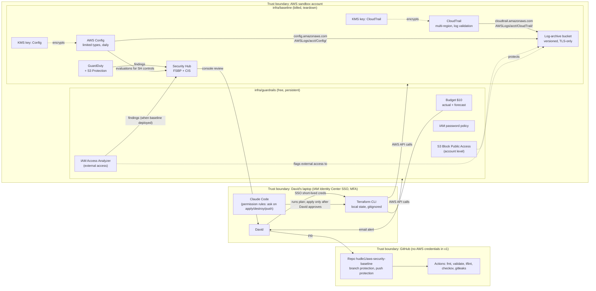
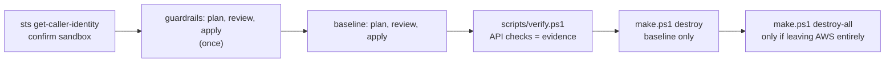

# Architecture

Terraform baseline for one personal AWS sandbox account, region `us-east-1`. Two root modules, split by **lifecycle and cost**, not as a security boundary (both share the same account and admin credentials).

| Stack | Contents | Cost | Lifecycle |
| --- | --- | --- | --- |
| `infra/guardrails` | Budget `monthly-10-usd` (imported), IAM password policy, account-level S3 Block Public Access, IAM Access Analyzer (external access) | Free | Persistent, never torn down for cost |
| `infra/baseline` | CloudTrail + 2 KMS keys + log-archive bucket, GuardDuty, Security Hub (FSBP + CIS), AWS Config | Billed | Deployed for demos, destroyed after |

## Diagram

## Who writes to what

| Writer | Principal | Target | Scoped by |
| --- | --- | --- | --- |
| CloudTrail | `cloudtrail.amazonaws.com` | `s3://<bucket>/AWSLogs/<acct>/CloudTrail/` | Bucket policy: `aws:SourceArn` = this trail, `aws:SourceAccount`, `s3:x-amz-acl = bucket-owner-full-control` |
| CloudTrail | `cloudtrail.amazonaws.com` | CloudTrail KMS key | Key policy: `kms:EncryptionContext:aws:cloudtrail:arn`, `aws:SourceArn` |
| AWS Config | Config service role (assumed by `config.amazonaws.com`) | `s3://<bucket>/AWSLogs/<acct>/Config/` | Bucket policy: `aws:SourceAccount`; role policy limited to that prefix |
| AWS Config | Config service role | Config KMS key | Key policy: only the Config role, encrypt/generate data key |
| GuardDuty | GuardDuty service | Security Hub findings | Built-in integration; reads CloudTrail management events, VPC Flow Logs, DNS and S3 data events **independently** of our trail |
| Security Hub | Security Hub service-linked role | Config rules for its controls | Requires Config recording; controls on unrecorded resource types show "no data" |
| IAM Access Analyzer | Access Analyzer service-linked role | Findings (own console; Security Hub when deployed) | Reads resource policies only; account zone of trust |
| Terraform | David's SSO role | Both stacks | Human approval for every apply/destroy; `allowed_account_ids` pins the sandbox |

**Cross-stack dependency:** account-level S3 Block Public Access (guardrails) is a backstop for the log-archive bucket (baseline). The bucket also sets its own bucket-level BPA so it stays protected even if the account setting changes, but guardrails must never be destroyed to save cost.

## Deploy and teardown

- Every `apply`/`destroy` shows a plan and waits for a human "yes". `-auto-approve` is denied in Claude Code settings.
- Teardown leaves two KMS keys in **pending deletion** (7-day window, not billed) and empties the versioned log bucket. Both are acceptable in a sandbox and wrong in production (see threat model).
- State is local and gitignored. Remote state (S3 + locking, separate account) is a production improvement.
